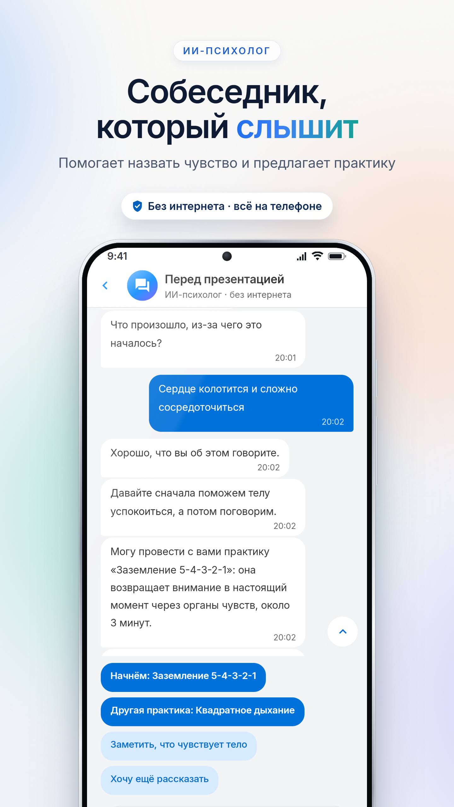
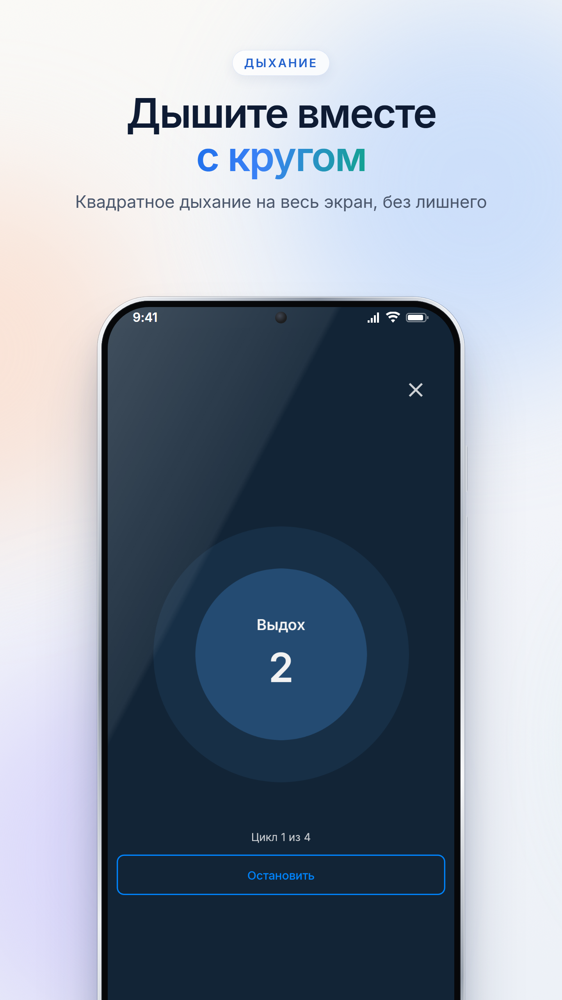
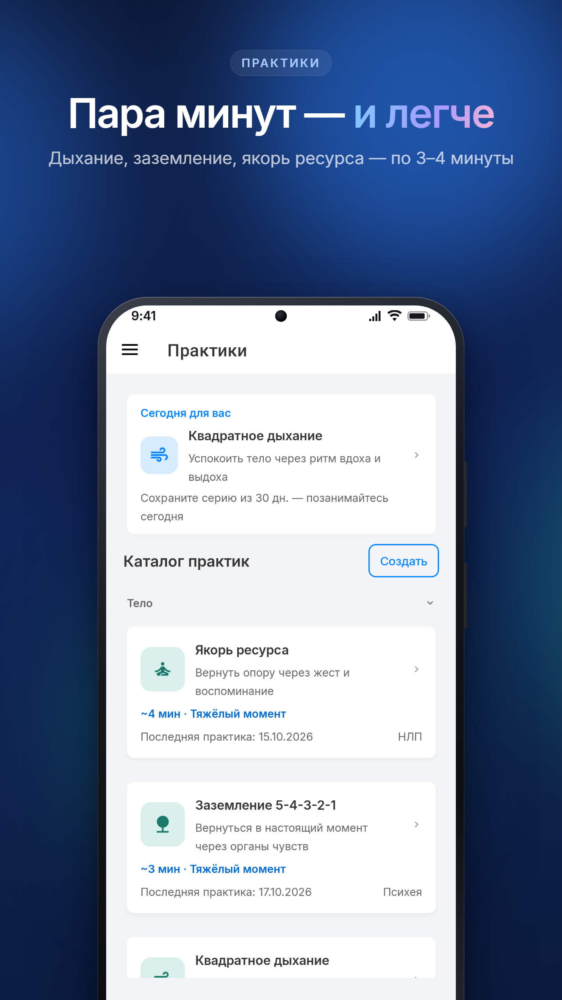
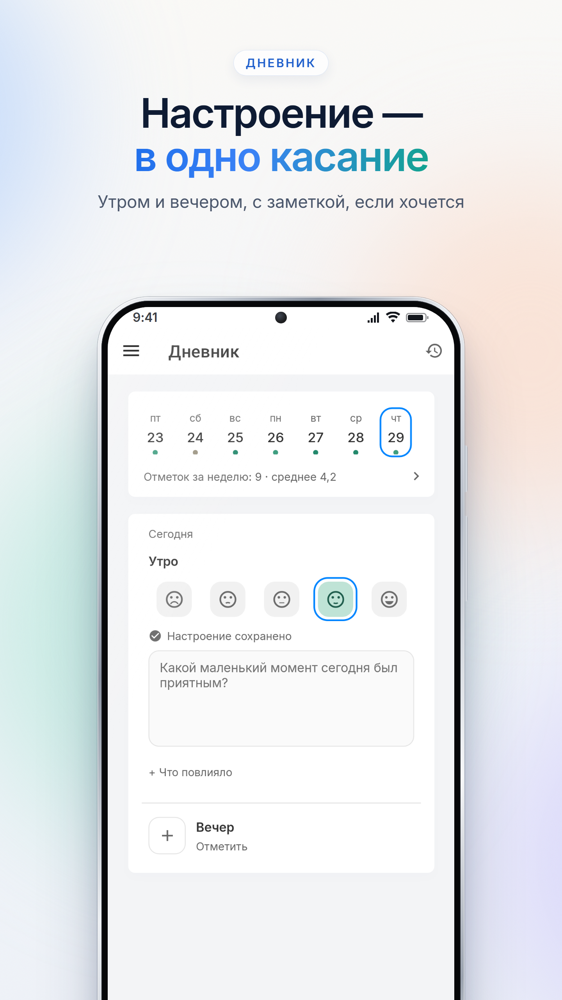
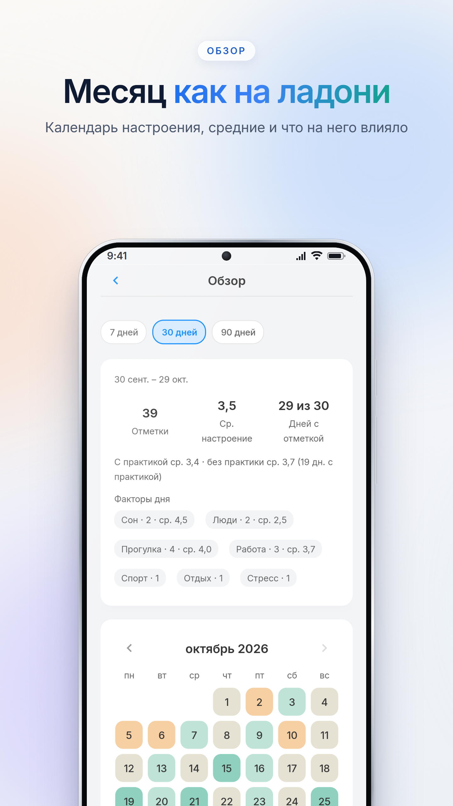
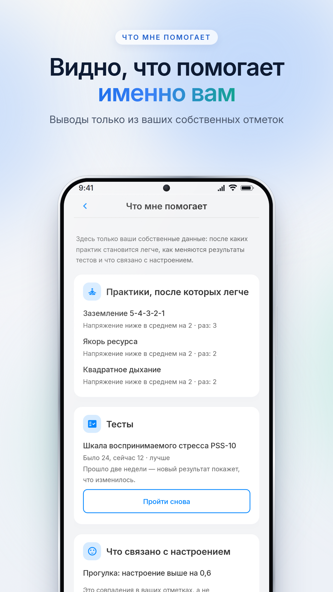
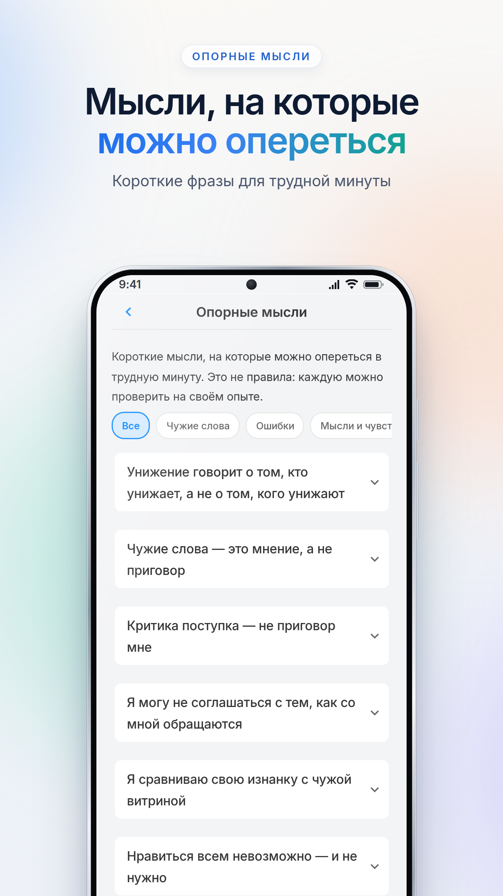
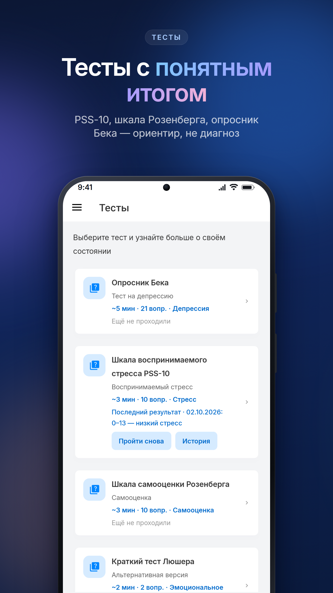

<div align="center">

# 🧠 Psychology App

**Психологическая самопомощь на телефоне — даже без интернета**

Практики при тревоге и стрессе, ИИ-психолог, дневник настроения и тесты. Записи, разговоры и результаты остаются на устройстве;
аккаунт и регистрация не нужны.

[](https://www.rustore.ru/catalog/app/com.subconscious.psychologyapp)
[](https://play.google.com/store/apps/details?id=com.subconscious.psychologyapp)
[](https://dotnet.microsoft.com/)
[](https://dotnet.microsoft.com/apps/maui)
[](LICENSE)

</div>

<table>
<tr>
<td align="center" width="25%"><br><sub><b>Собеседник, который слышит</b></sub></td>
<td align="center" width="25%"><br><sub><b>Дышите вместе с кругом</b></sub></td>
<td align="center" width="25%"><br><sub><b>Пара минут — и легче</b></sub></td>
<td align="center" width="25%"><br><sub><b>Настроение — в одно касание</b></sub></td>
</tr>
<tr>
<td align="center"><br><sub><b>Месяц как на ладони</b></sub></td>
<td align="center"><br><sub><b>Видно, что помогает именно вам</b></sub></td>
<td align="center"><br><sub><b>Мысли, на которые можно опереться</b></sub></td>
<td align="center"><br><sub><b>Тесты с понятным итогом</b></sub></td>
</tr>
</table>

## Что умеет приложение

- **ИИ-психолог** — отзывается на слова человека, помогает назвать чувство, спрашивает силу переживания (0–10) и предлагает
  подходящую практику, а практики проводит в том же разговоре. Работает на устройстве, без сети и без облачной языковой
  модели. Устройство диалога: [`docs/chat-companion.md`](docs/chat-companion.md),
  [`docs/companion-understanding.md`](docs/companion-understanding.md); почему без языковой модели —
  [`docs/local-llm.md`](docs/local-llm.md).
- **Практики** — квадратное дыхание на весь экран, заземление 5-4-3-2-1, позиция наблюдателя, запись мысли, один
  маленький шаг, добрые слова себе, якорь ресурса и другие; свои практики; напряжение до и после (0–10).
- **Дневник настроения** — отметка утром и вечером за одно касание, факторы (сон, люди, прогулка…), заметка, календарь
  недели, месяца и года, график с отметками практик, выгрузка в CSV.
- **Виджет и напоминания** — виджет на главном экране Android: настроение в одно касание и практика дня. Напоминание об
  отметке может приходить в то время, когда человек обычно отмечается, и не приходит, если отметка уже есть.
- **Что мне помогает** — выводы только из своих записей: после каких практик напряжение ниже, как изменились результаты
  тестов, какие факторы дневника связаны с настроением.
- **Тесты** — PSS-10, шкала самооценки Розенберга, опросник Бека и другие; итог объяснён простыми словами и не является
  диагнозом.
- **Тело** — где и как ощущается чувство: силуэт, ощущения, догадки о чувствах для проверки, практики и собственные
  закономерности; при боли или сильном ощущении — сначала к врачу ([`docs/body-check.md`](docs/body-check.md)).
- **Материалы** — подборка «Для вас», курсы самопомощи по дням, статьи, молитвы и цитаты
  ([`docs/articles-and-courses.md`](docs/articles-and-courses.md)).
- **Безопасность** — короткая проверка «Как я сейчас?», план безопасности и горячие линии; при признаках кризиса
  приложение сразу показывает путь к помощи. Модель угроз: [`docs/threat-model.md`](docs/threat-model.md).
- **Данные на устройстве** — зашифрованная база SQLite, сервера и аналитики с текстом нет; резервную копию можно сохранить
  и вернуть.

Внизу экрана четыре вкладки: Практики, ИИ-психолог, Тесты, Дневник. Профиль, «Что мне помогает», «Тело», материалы, срочная
помощь и параметры — в меню ☰. Интерфейс на русском и английском, светлая и тёмная тема.

> Psychology App не заменяет врача или психолога и не ставит диагнозов. Клинические тексты перед выпуском проверяет
> психолог: [`docs/clinical-review.md`](docs/clinical-review.md).

## Архитектура

Модульный монолит: Clean Architecture на уровне решения, Feature-Sliced Design внутри Presentation. Границы слоёв
проверяют архитектурные тесты. Подробно — в [`ARCHITECTURE.md`](ARCHITECTURE.md).

| Проект | Роль |
| --- | --- |
| `PsychologyApp.Domain` | сущности, value objects, доменные правила |
| `PsychologyApp.Application` | сценарии, DTO, порты; чат ИИ-психолога, выводы «Что мне помогает» |
| `PsychologyApp.Infrastructure` | SQLite (Dapper, шифрование), репозитории |
| `PsychologyApp.Bootstrap` | корень композиции |
| `PsychologyApp.Presentation.Core` | логика представления без MAUI, строки RU/EN (`AppStrings`) |
| `PsychologyApp.Presentation` | .NET MAUI: App, Pages, Widgets, Features, Entities, Shared |
| `*.Tests`, `PsychologyApp.Testing` | модульные, интеграционные и архитектурные тесты |

Стек: .NET 10, .NET MAUI 10, Dapper, SQLite с шифрованием (SQLitePCLRaw e_sqlite3mc), CommunityToolkit.Maui, Material
Icons, xUnit. Платформы: Android 5.0+ (API 21) — основная; проект также собирается под iOS 11+ и Mac Catalyst 13.1+.

## Сборка и запуск

Скрипты для Git Bash (Windows) и bash (Linux/macOS), из корня репозитория:

```bash
bash scripts/android-doctor.sh    # что есть и чего не хватает
bash scripts/android-setup.sh     # Android SDK в каталоге пользователя и эмулятор
bash scripts/emu.sh               # запустить эмулятор
bash scripts/android-run.sh       # собрать и запустить отладочную копию com.subconscious.psychologyapp.dev
bash scripts/android-release.sh   # релизные AAB и APK в artifacts/release/<версия>/
```

Отладочная копия `.dev` ставится рядом с настоящим приложением и не трогает его данные. Релизный скрипт подписывает
ключом выпуска и отказывает, если есть незакоммиченные изменения, версии не согласованы, CHANGELOG не поднят, падают тесты
или пакет подписан отладочным ключом.

Тесты:

```bash
dotnet test PsychologyApp.Domain.Tests
dotnet test PsychologyApp.Application.Tests
dotnet test PsychologyApp.Infrastructure.Tests
dotnet test PsychologyApp.Integration.Tests
dotnet test PsychologyApp.Presentation.Tests
```

CI запускает тесты и проверку Release-сборки на эмуляторе (`android-smoke`) на каждый push и pull request рабочих веток.

## Скриншоты для магазинов

Готовые слайды на русском и английском — в [`store/screenshots`](store/screenshots), тексты для магазинов — в
[`store/listing-ru.md`](store/listing-ru.md). Как переснять: [`tools/store-screenshots/README.md`](tools/store-screenshots/README.md).
Все данные на снимках вымышленные.

## Для разработчиков

- Правила разработки (для людей и AI-агентов): [`AGENTS.md`](AGENTS.md)
- Как оформлять изменения: [`CONTRIBUTING.md`](CONTRIBUTING.md)
- История изменений: [`CHANGELOG.md`](CHANGELOG.md)

## Лицензия

[MIT](LICENSE)
